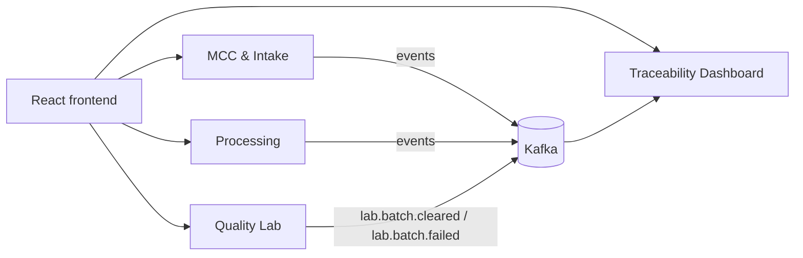
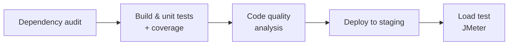

# Wonrich Dairy — Quality Monitoring & Traceability System

A microservices-based quality-monitoring and traceability platform for **Wonrich Dairy (Pvt) Ltd**, built as a SLIIT 3rd-year Case Study Project.

Technicians record quality tests at every handover point: the milk chilling centre, factory intake, processing and the quality lab. Quality Control Officers monitor production on live dashboards. When a product fails, they can trace its batch back through every stage to find where it went wrong.

## Repositories

| Repository | Purpose |
|---|---|
| [mcc-intake-service](https://github.com/wonrich-dairy/mcc-intake-service) | MCC & Intake Service — raw milk quality metrics, bowser dispatch notes, factory-intake condition logging |
| [quality-lab-service](https://github.com/wonrich-dairy/quality-lab-service) | Quality Lab Service — laboratory test results and quality grading |
| [processing-service](https://github.com/wonrich-dairy/processing-service) | Processing Service — pasteurisation, homogenisation, and production batch tracking |
| [traceability-dashboard-service](https://github.com/wonrich-dairy/traceability-dashboard-service) | Traceability Dashboard Service — end-to-end batch traceability and reporting |
| [frontend](https://github.com/wonrich-dairy/frontend) | React frontend — unified UI for all services |
| [shared-test-panel](https://github.com/wonrich-dairy/shared-test-panel) | Shared Test Panel — reusable test-parameter library consumed by multiple services |
| [wonrich-infra](https://github.com/wonrich-dairy/wonrich-infra) | Shared infrastructure — Kafka broker and topics, Prometheus and Grafana |

## Architecture



Each service is deployed independently, owns its own database, and exposes a REST API. Services publish domain events to Kafka. The Traceability Dashboard consumes those events to build the end-to-end view of each batch.

## Tech Stack

- **Backend:** ASP.NET Core + Entity Framework
- **Database:** MySQL (one per service)
- **Frontend:** React
- **Messaging:** Apache Kafka
- **Hosting:** Azure App Service (staging & production)
- **CI/CD:** GitHub Actions
- **Containers:** Docker / docker-compose for local development
- **Monitoring:** Prometheus + Grafana

## Branching Strategy

All repositories follow the same convention:
- `main` — protected, production-ready code
- `develop` — protected integration branch
- `feature/SCRUM-<key>-<description>` — work branches, merged into `develop` via reviewed PR (1 approving review required)

---

## Microservice Testing Pipeline (SE3112)

All test layers run from one GitHub Actions pipeline. A merge to `develop` runs the stages in order, and each stage gates the next one:



| Stage | Testing area | Tool | Fails the pipeline when |
|---|---|---|---|
| Build & unit tests | Unit Testing & Mocking | xUnit, `TODO: Moq / NSubstitute` | any test fails |
| Code quality analysis | Code Quality & Metrics | `TODO: SonarCloud / coverage tool` | `TODO: quality gate rule` |
| Load test | Load & Performance Testing | Apache JMeter 5.6.3 | p95 > 2000 ms (NFR1) or errors > 1% |
| `TODO: fourth stage` | `TODO: fourth role` | `TODO` | `TODO` |

**Unified reporting:** every stage writes its results to the run's **Summary** page in GitHub Actions and uploads its full report as a run artifact. All results for one run are therefore in one place.

### Running the pipeline

| How | Command |
|---|---|
| Automatically | Merge to `develop` |
| Whole pipeline, by hand | Actions → **`TODO: CI/CD workflow name`** → Run workflow |
| Load test only | Actions → **Performance test (JMeter)** → Run workflow → choose `load`, `stress` or `spike` |
| From the CLI | `gh workflow run performance.yml -R wonrich-dairy/quality-lab-service -f profile=stress` |

### Running locally

```bash
# Unit tests with coverage
dotnet test --collect:"XPlat Code Coverage"

# Code quality
TODO: command

# Load test against staging (needs JMeter 5.6.3 and Python 3)
read -rs PERF_PASSWORD; export PERF_PASSWORD
HOST=<quality-lab host> AUTH_HOST=<auth host> PERF_USERNAME=<user> perf/run.sh load   # or stress / spike
unset PERF_PASSWORD
```

Tool setup and full details for each area are in that area's own documentation, linked below.

### Who did what

| Member | Student ID | Testing area | Implemented in | Details |
|---|---|---|---|---|
| J A M Manoharie | IT24103443 | Load & Performance Testing | quality-lab-service | [Load testing guide](https://github.com/wonrich-dairy/quality-lab-service/blob/develop/docs/performance-testing.md) |
| `TODO` | `TODO` | Unit Testing & Mocking | `TODO` | `TODO: link` |
| `TODO` | `TODO` | Code Quality & Metrics | `TODO` | `TODO: link` |
| `TODO` | `TODO` | `TODO: fourth role` | `TODO` | `TODO: link` |

#### Load & Performance Testing — IT24103443

JMeter simulates quality analysts using the Quality Lab Service on staging. Each one signs in, opens the work queue, reads a batch, records a chemical panel and reads it back. The test runs automatically after every staging deploy, and on demand with three load profiles:

| Profile | Shape | Result on staging |
|---|---|---|
| `load` | 10 users, steady | Meets NFR1 (p95 ≤ 2 s) |
| `stress` | 10 → 25 → 50 users | Meets NFR1 up to 25 users; saturates between 25 and 50 (p95 ~3 s) |
| `spike` | 5 → 50 → 5 users | 0% errors through a 10× burst; latency recovers to baseline |

A per-phase results table shows the exact step where performance breaks, which a whole-run average hides. The work queue is the slowest endpoint and the first optimisation target.

#### Unit Testing & Mocking — `TODO: IT no.`

`TODO: two or three lines — what is tested, how test doubles isolate the service logic, how parameterised cases are used, and the coverage achieved.`

#### Code Quality & Metrics — `TODO: IT no.`

`TODO: two or three lines — tool, quality gate, key metrics (coverage, code smells, technical debt) and where the dashboard is.`

#### `TODO: fourth role` — `TODO: IT no.`

`TODO`

---

## Team

SLIIT ASE — Group 16: IT24103473 · IT24103456 · IT24103428 · IT24103443
