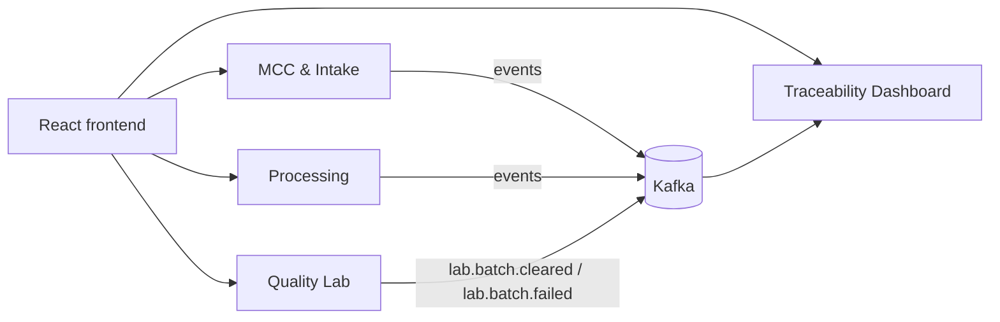
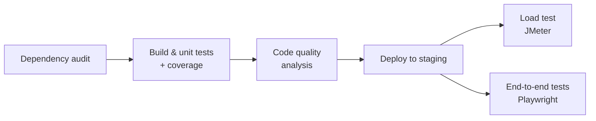
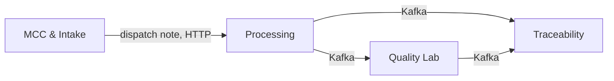

# Wonrich Dairy — Quality Monitoring & Traceability System

A microservices-based quality-monitoring and traceability platform for **Wonrich Dairy (Pvt) Ltd**, built as a SLIIT 3rd-year Case Study Project.

Technicians record quality tests at every handover point: the milk chilling centre, factory intake, processing and the quality lab. Quality Control Officers monitor production on live dashboards. When a product fails, they can trace its batch back through every stage to find where it went wrong.

## Repositories

| Repository | Purpose |
|---|---|
| [mcc-intake-service](https://github.com/wonrich-dairy/mcc-intake-service) | MCC & Intake Service — raw milk quality metrics, bowser dispatch notes, factory-intake condition logging |
| [quality-lab-service](https://github.com/wonrich-dairy/quality-lab-service) | Quality Lab Service — laboratory test results and quality grading |
| [processing-service](https://github.com/wonrich-dairy/processing-service) | Processing Service — pasteurisation, homogenisation, and production batch tracking |
| [traceability-dashboard-service](https://github.com/wonrich-dairy/traceability-dashboard-service) | Traceability Dashboard Service — end-to-end batch traceability and reporting |
| [frontend](https://github.com/wonrich-dairy/frontend) | React frontend — unified UI for all services |
| [shared-test-panel](https://github.com/wonrich-dairy/shared-test-panel) | Shared Test Panel — reusable test-parameter library consumed by multiple services |
| [wonrich-infra](https://github.com/wonrich-dairy/wonrich-infra) | Shared infrastructure — Kafka broker and topics, Prometheus and Grafana |

## Architecture



Each service is deployed independently, owns its own database and exposes a REST API. Services publish domain events to Kafka, and the Traceability Dashboard consumes those events to build an end-to-end view of each batch.

## Tech Stack

- **Backend:** ASP.NET Core + Entity Framework
- **Database:** MySQL (one per service)
- **Frontend:** React
- **Messaging:** Apache Kafka
- **Hosting:** Azure App Service (staging & production)
- **CI/CD:** GitHub Actions
- **Containers:** Docker / docker-compose for local development
- **Monitoring:** Prometheus + Grafana

## Branching Strategy

All repositories follow the same convention:
- `main` — protected, production-ready code
- `develop` — protected integration branch
- `feature/SCRUM-<key>-<description>` — work branches, merged into `develop` via reviewed PR (1 approving review required)

---

## Microservice Testing Pipeline (SE3112)

Every test layer runs from the service's GitHub Actions pipeline. A merge to `develop` runs the stages in order, and each stage gates the next:



| Stage | Testing area | Tool | Fails the pipeline when |
|---|---|---|---|
| Build & unit tests | Unit Testing & Mocking | xUnit, NSubstitute, Coverlet | any test fails |
| Code quality analysis | Code Quality & Metrics | `TODO: SonarCloud / coverage tool` | `TODO: quality gate rule` |
| Load test | Load & Performance Testing | Apache JMeter 5.6.3 | p95 > 2000 ms (NFR1) or errors > 1% |
| End-to-end tests | UI / E2E Testing | Playwright 1.64 (TypeScript) | any test fails (a known defect is an expected failure until it is fixed) |

**Unified reporting:** every stage writes its results to the run's **Summary** page in GitHub Actions and uploads its full report as a run artifact, so all the results for one run are in one place.

### Running the pipeline

| How | Command |
|---|---|
| Automatically | Merge to `develop` |
| Whole pipeline, by hand | Actions → **CI/CD — Processing Service** → Run workflow |
| Load test only | Actions → **Performance test (JMeter)** → Run workflow → choose `load`, `stress` or `spike` |
| End-to-end tests only | Actions → **End-to-end tests (Playwright)** → Run workflow → choose `all`, `api` or `ui` |
| From the CLI | `gh workflow run performance.yml -R wonrich-dairy/<quality-lab-service \| processing-service> -f profile=stress` |
| End-to-end, from the CLI | `gh workflow run e2e.yml -R wonrich-dairy/processing-service -f project=all` |

### Running locally

```bash
# Unit tests with coverage, from processing-service
dotnet test --filter "FullyQualifiedName~ProcessingService.Tests.Unit" --settings coverage.runsettings --collect:"XPlat Code Coverage"

# Code quality
TODO: command

# Load test against staging, from the service's repository (needs JMeter 5.6.3 and Python 3)
read -rs PERF_PASSWORD; export PERF_PASSWORD
HOST=<service host> AUTH_HOST=<auth host> PERF_USERNAME=<user> perf/run.sh load   # or stress / spike
unset PERF_PASSWORD

# End-to-end tests against staging, from processing-service (needs Node 20+ and Google Chrome)
cd tests/e2e && npm ci
npx playwright test                          # everything: the services' APIs and the frontend
npx playwright test --project=ui --headed    # watch the browser
npm run report                               # HTML report
```

Tool setup and full details for each area are in that area's own documentation, linked below.

### Who did what

| Member | Student ID | Testing area | Implemented in | Details |
|---|---|---|---|---|
| J A M Manoharie | IT24103443 | Load & Performance Testing | quality-lab-service, processing-service | Load testing guides: [Quality Lab](https://github.com/wonrich-dairy/quality-lab-service/blob/develop/docs/performance-testing.md) · [Processing](https://github.com/wonrich-dairy/processing-service/blob/develop/docs/performance-testing.md) |
| Abeyweera AMPVTC | IT24103428 | Unit Testing & Mocking | processing-service | [Unit testing section](https://github.com/wonrich-dairy/processing-service/blob/develop/README.md#unit-testing--mocking-se3112) |
| `TODO` | `TODO` | Code Quality & Metrics | `TODO` | `TODO: link` |
| Alen Oshan | IT24103473 | UI / E2E Testing | processing-service | [End-to-end testing guide](https://github.com/wonrich-dairy/processing-service/blob/develop/docs/e2e-testing.md) · [PR #37](https://github.com/wonrich-dairy/processing-service/pull/37) |

#### Load & Performance Testing — IT24103443

JMeter load tests run against two services on staging. They run automatically after every staging deploy (the `load` profile) and on demand with three load profiles:

| Profile | Shape | Question it answers |
|---|---|---|
| `load` | 10 users, steady | Does the service meet NFR1 (p95 ≤ 2 s) at normal peak load? |
| `stress` | 10 → 25 → 50 users | At what load does it stop meeting NFR1? |
| `spike` | 5 → 50 → 5 users | Does it survive a sudden 10× burst and recover? |

A per-phase results table shows the step where performance breaks, which a whole-run average would hide.

**Quality Lab Service.** Each virtual user is a quality analyst: they open the work queue, read a batch, record a chemical panel and read it back.

| Profile | Result on staging |
|---|---|
| `load` | Meets NFR1 |
| `stress` | Meets NFR1 up to 25 users. Saturates between 25 and 50: throughput stops scaling and p95 reaches about 3 s |
| `spike` | 0% errors through the burst; latency recovers to baseline |

The work queue is the slowest endpoint and the first optimisation target.

**Processing Service.** Each virtual user is a processing technician: they list active tanks and stages, log a tank temperature, read the last reading and list processing runs. Writes go to a reserved test tank (ST-99), which is deleted at the end of each run together with its readings, so every run leaves staging as it found it.

| Profile | Users | Req/s | p50 | p95 | Errors | Result |
|---|---|---|---|---|---|---|
| `load` | 10 | 6.2 | 170 ms | 185 ms | 0% | ✅ Meets NFR1 |
| `stress`, step 1 | 10 | 6.3 | 229 ms | 243 ms | 0% | ✅ |
| `stress`, step 2 | 25 | 15.6 | 228 ms | 243 ms | 0% | ✅ |
| `stress`, step 3 | 50 | 30.5 | 230 ms | 525 ms | 0% | ✅ No saturation |
| `spike`, baseline | 5 | 3.2 | 208 ms | 612 ms | 0% | ✅ |
| `spike`, burst | 50 | 33.2 | 206 ms | 600 ms | 0% | ✅ |
| `spike`, recovery | 5 | 3.4 | 206 ms | 605 ms | 0% | ✅ |

Processing Service scales linearly up to 50 users: throughput grows in step with the number of users, and the median stays around 230 ms. It meets NFR1 at every load tested, so its capacity is above 50 concurrent users. Quality Lab, by contrast, saturates between 25 and 50. `read: active tanks` is consistently the slowest Processing endpoint (p95 roughly 500–680 ms, against about 200 ms for the others).

#### Unit Testing & Mocking — `IT24103428`

Unit tests for the Processing Service use xUnit with NSubstitute. They run in the **Build & unit tests** stage on every pull request and every push to `develop`, and a failing test stops the pipeline before any deployment. Each test class replaces only the collaborators that are slow or unpredictable, so a test fails only when the service's own logic is wrong. No production code was changed to make this possible.

| Service under test | What the tests check | Test doubles |
|---|---|---|
| `ProcessingRunService` (milk unloading) | dispatch-note validation, quantity limit with a 0.01 kg tolerance, temperature range, MCC outage | `IMccDispatchClient` stub and mock, fake clock |
| `ProcessingStageService` (heating, homogeniser, pasteuriser, cooling) | stage order, empty-tank rule, temperature limits, stage durations, completion event | `IOutboxWriter` mock, fake clock |
| `TankTemperatureLogService` | temperature range, rounding, note trimming | fake clock |
| Tank code rules | valid and invalid tank codes | none (pure logic) |

How the doubles isolate the logic:
- **Stub:** `IMccDispatchClient` returns a canned answer ("dispatch exists", "not found") or throws, to test how the service reacts when the MCC service is down.
- **Mock:** `IOutboxWriter` is verified, not just used. A test asserts that exactly one event is written on success, to the right topic and keyed by batch, and that nothing is written when validation fails. When the outbox itself fails, the stage is not saved.
- **Fake clock:** `FakeTimeProvider` replaces the system clock, so durations are exact (59 seconds is 0 minutes, 60 seconds is 1 minute) with no sleeping.
- **In-memory database:** EF Core InMemory replaces MySQL. The `DbContext` is not mocked, because the services run real EF queries.

Parameterised cases use `[Theory]` with `[InlineData]` and `[MemberData]` and test each limit just below, at and just above the boundary, for example heating 39.99 / 40 / 65 / 65.01 °C, pasteuriser 79.99 / 80 / 85 / 85.01 °C, and a dispatch quantity at the remaining amount, +0.01 kg and +0.02 kg.

| Measure | Result |
|---|---|
| Unit test cases | 56 (in 20 test methods), 0 failures |
| Whole test project | 81 passing (the 25 existing API and Kafka tests plus the 56 unit tests) |
| Unit test run time | about 2 seconds, with no database, Kafka or network |
| Line coverage | `ProcessingRunService` 100%, `ProcessingStageService` 84.8%, `TankTemperatureLogService` 100% |

Each pipeline run writes the coverage table to its **Summary** page and uploads the Cobertura file and an HTML report as the `test-results` artifact, so the Code Quality stage can read them. Full details are in the Unit Testing & Mocking section of the processing-service README.

#### Code Quality & Metrics — `TODO: IT no.`

`TODO: two or three lines — tool, quality gate, key metrics (coverage, code smells, technical debt) and where the dashboard is.`

#### UI / E2E Testing — IT24103473

Playwright tests run against staging after every staging deploy of the Processing Service, beside the load test, and by hand. Processing sits between the other services, so the suite tests it where it meets them: every call carries a token from the auth service, and the hops between services are made by the services themselves, over HTTP and Kafka.



| Suite | Tests | What it proves |
|---|---|---|
| Milk to a cleared batch | 9 | One delivery through all five services: intake dispatches a bowser; processing checks the note in intake, unloads it, passes factory QC, allocates the batch and runs the four stages; quality-lab receives it over Kafka and the analyst passes it; traceability shows it cleared |
| Processing rules | 24 | Dispatch-note checks, unload limits, an occupied mixing tank, one stage at a time, heating (40–65 °C) and pasteuriser (80–85 °C) limits at their boundaries, a load that fails QC is held |
| Role-based access | 51 | Six routes under seven roles, no token, a forged role claim, a stripped signature |
| Unloading Bay (browser) | 14 | The deployed frontend in Chrome: unloading a bowser intake dispatched, the sensory checks and quantity limit, an unknown note, a partial unload, sign-in and role-gated screens |

**Result on staging:** 98 tests, all passing, in under 2 minutes.

How the tests are built: page objects with role and label locators; data made the way the system makes it (each test takes a fresh bowser from intake's API); arrange through the API, act through the screen, assert through the API; `expect.poll` instead of fixed sleeps for Kafka hops; boundary values on each temperature limit; authorization checked without writing data (a refused role gets 403 before the body is read).

**Defects found.** The first three are kept as expected-failure tests (`test.fail`), so the pipeline stays green until each is fixed and then flags it:

| Defect | Risk |
|---|---|
| Allocation skips the QC check when the request names the run | Untested milk can go into production |
| Allocation never checks the mixing tank's capacity | A 300 kg tank accepts 301 kg |
| Stage order stops going back but not skipping ahead | A batch can go from heating straight to the pasteuriser or to cooling |
| Mixing tanks are never emptied after cooling | Each batch uses up one of 99 tank codes |
| The deployed frontend returns 404 for deep links | Refreshing a screen or opening a bookmark fails |

---

## Team

Group 16: IT24103473 · IT24103456 · IT24103428 · IT24103443
